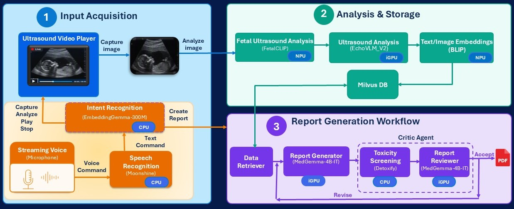

# Agentic Ultrasound Analyzer – Reference Implementation

## Table of Contents
- [Overview](#overview)
- [Demo](#demo)
- [Architecture](#architecture)
  - [High-Level Components](#high-level-components)  
- [Validated System and Benchmark Results](#validated-system-and-benchmark-results)
  - [Validated Hardware](#validated-hardware)  
  - [Validated Software](#validated-software)  
  - [Latency Benchmark Summary](#latency-benchmark-summary)  
- [Get Started](#get-started)  
  - [Windows](#windows)  
  - [Linux](#linux)

---

## Overview

> **Ready to deploy?** Jump directly to [Get Started](#get-started)

The Agentic Ultrasound Analyzer is a multi-modal, multi-model agentic solution to automate ultrasound analysis and report generation by securely running 7 AI models locally on the edge, while enabling voice support for sonographers.

This solution demonstrates:
- Conversion of voice command into text using Moonshine's Tiny Streaming model
- Mapping text command into action using EmbeddingGemma-300M model    
- Classification of ultrasound image into fetal/non-fetal and classifying fetal planes using FetalCLIP model  
- Analyzing ultrasound image and generating clinical insights using EchoVLM_v2 model  
- Conversion of analysis output and ultrasound image into embeddings with BLIP model and storing them in Milvus DB  
- Generating toxic-free, critic-reviewed clincial report with LangGraph workflow using detoxify and MedGemma-1.5-4B-IT models  

---

## Demo


---

## Architecture



The system is deployed within a **Intel® Core™ Ultra-based edge device**.

### High-Level Components
- **Automatic Speech Recognition** – Converts voice command into text  
- **Intent Recognition** – Converts the transcripted text into intended action on the ultrasound video  
- **Fetal Ultrasound Analysis** – Classifies ultrasound image into fetal/non-fetal and classifies anatomical plane of fetal ultrasounds  
- **Ultrasound Analysis with EchoVLM_v2** – Reports major findings and their clinical interpretation from ultrasound images  
- **Agentic Report Generation** - Generates ultrasoud report, runs toxicity detection, reviews report and saves it in pdf format

---

## Validated System and Benchmark Results

### Validated Hardware

| Model | Processor | GPU | Memory | OS | Software |
|------|----------|-------|---------|----|--------------------|
| GMKtec Mini PC | Intel® Core™ Ultra X7 358H | Intel® Arc™ B390 | 64GB | Windows 11 | GPU Driver: 32.0.101.9150, NPU Driver: 32.0.100.5540, Python: 3.12.0, Docker Desktop: 4.75.0, Milvus: 3.0.3 |
| Dell AI PC | Intel® Core™ Ultra 7 155H | Intel® Arc™ Graphics | 64GB | Windows 11 | GPU Driver: 32.0.101.8860, NPU Driver: 32.0.100.5540, Python: 3.14.6, WSL 2.6.1.0 (Ubuntu 24.04), Milvus: 3.0.5 |

---

### Latency Benchmark Summary

| Model | Fetal Ultrasound Analysis(FetalCLIP) | Ultrasound Analysis(EchoVLM_v2) | Report Generation(MedGemma-1.5-4B-it) |
|-------|--------------------------------------|---------------------------------|---------------------------------------|
| GMKtec Mini PC | 0.02s (GPU) | 11.3s (GPU) | 12s (GPU) |
| Dell AI PC | 0.1s (GPU) | 23.3s (GPU) | 20.7s (GPU) |

---

## Get Started

### Prerequisites
| OS | Tools |
|--------------|-------------------------------------------|
| Windows 11   | Docker Desktop or WSL2, Python: 3.12-3.14 |
| Ubuntu 24.04 | Docker, Python: 3.12-3.14 |  

### Installation 
#### Windows  
Follow the setup steps in sequence:

1) Install dependencies
```
.\install_dependencies.bat
```   
2) Start backend server
```
cd scripts
.\start_app.bat
```
**Note**: Press Ctrl+C to stop the application   

3) Start blip embedding service in a new terminal
```
cd scripts
.\start_blip_service.bat
```
**Note**: All AI models are set to run on CPU by default. To override it, set the environment variable CPU_MODE to 0 (Windows PowerShell: $env:CPU_MODE=0, Windows Command-Line: set CPU_MODE=0, Linux: export CPU_MODE=0) before running the steps 2 and 3.

4) Uninstall application dependencies and deletes models  
```
.\uninstall.bat
```

#### Linux  
Follow the setup steps in sequence:

1) Install system and application dependencies
```
sudo bash setup.sh
bash install_dependencies.sh
```   
2) Start backend server
```
cd scripts
bash start_app.sh
```
3) Start blip embedding service in a new terminal
```
cd scripts
bash start_blip_service.sh
```
4) Uninstall application dependencies and deletes models  
```
bash uninstall.sh
```

#### Application Logs   

The installation logs and backend server logs are saved in the following files:  
scripts\logs\install_dependencies.log  
scripts\logs\flask_backend_startup.log  

#### Local Service Ports

`BACKEND_SERVER_PORT` defaults to `15000` and `BLIP_SERVICE_PORT` defaults to `15100`.
Change these variables after loading the script to override them. Restart the services
after changing ports. `BLIP_SERVICE_URL`, when explicitly set, overrides the BLIP client URL;
otherwise the client connects to localhost using `BLIP_SERVICE_PORT`. The BLIP `--port`
argument still overrides its environment setting.

The launcher opens the frontend through Flask. With the default ports, use
`http://127.0.0.1:15000/video_player_intent.html` and `http://127.0.0.1:15000/admin.html`.
Do not open the HTML files directly: browser API requests use the page's server address.

---

## Disclaimer

This solution is a **reference implementation** and is not intended for direct clinical deployment without appropriate validation, security hardening, and regulatory compliance.

---