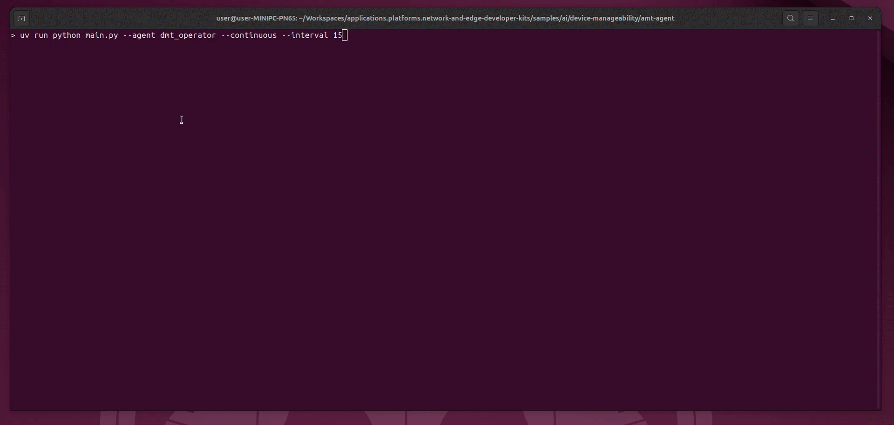

# Device Manageability — Autonomous Intel AMT / DMT Self-Healing

An agentic sample for out-of-band device management on Intel® endpoints with
Intel® Active Management Technology (Intel® AMT). It pairs an MCP server that
exposes Intel AMT device management as tools with an autonomous agent that
uses those tools to audit, diagnose, and self-heal managed PCs — including
machines that are hung, crashed, or otherwise unreachable over the OS
network stack.

The two components communicate over the [Model Context Protocol](https://modelcontextprotocol.io)
(MCP) and can be run independently or together:

| Project | Role | Description |
| :--- | :--- | :--- |
| [amt-mcp-server/](./amt-mcp-server) | MCP **provider** | Exposes Intel AMT / DMT (Device Management Toolkit) device management — screen capture over KVM, System Event Log (SEL) reads, and out-of-band power actions — as MCP tools over SSE, stdio, or streamable HTTP. |
| [amt-agent/](./amt-agent) | MCP **client** | Runs the `dmt_operator` agent, which continuously audits registered devices, diagnoses failures with a vision-language model (VLM) plus SEL analysis, self-heals with out-of-band power actions, and produces PDF incident reports. Also exposes its own FastAPI control/status API. |

## How it fits together

```
dmt_operator agent (amt-agent)
   │  MCP tools over SSE (default http://localhost:8000/sse)
   ▼
amt-mcp-server  ──── REST ────►  DMT Console
   │                              (devices, power, SEL, hardware)
   └── direct TCP/TLS ────────►  Intel AMT KVM (screen capture)
```

1. **`amt-mcp-server`** connects to a running DMT Console REST API and talks
   directly to Intel AMT KVM redirection to capture screens, read the SEL,
   and issue power actions (power cycle, reset, boot to BIOS/PXE, power
   on/off, sleep, hibernate).
2. **`amt-agent`** connects to `amt-mcp-server` as an MCP client, sends
   captured screens to an OpenAI-compatible vision model for diagnosis,
   classifies SEL events, and decides whether to remediate, contain
   (ransomware), or mark a device as resolved — then records a PDF
   incident report.

## Example



## Getting started

Each project has its own prerequisites, environment variables, and quick
start:

1. Start the MCP server first — see [amt-mcp-server/QUICK-START.md](./amt-mcp-server/QUICK-START.md)
   (or the full [amt-mcp-server/README.md](./amt-mcp-server/README.md)).
2. Then start the agent — see [amt-agent/QUICK-START.md](./amt-agent/QUICK-START.md)
   (or the full [amt-agent/README.md](./amt-agent/README.md)).

> **Before running:** both projects can issue out-of-band power actions
> (power cycle, reset, power off) against managed devices. Use a test
> endpoint before pointing either project at production hardware.

Both projects use Python and [Astral `uv`](https://docs.astral.sh/uv/) for
dependency management, and are set up and run independently with `uv sync`
and `uv run ...` from within their own directories.

## Testing

Each project has its own unit test suite, fully mocked (no Intel AMT/DMT
hardware, DMT Console, or network access required):

```bash
cd amt-mcp-server && uv sync --group test && uv run --group test pytest tests/ -v
cd amt-agent && uv sync --group test && uv run --group test pytest tests/ -v
```

See [amt-mcp-server/tests/README.md](./amt-mcp-server/tests/README.md) and
[amt-agent/tests/README.md](./amt-agent/tests/README.md) for what each suite
covers and its documented scope limitations.
