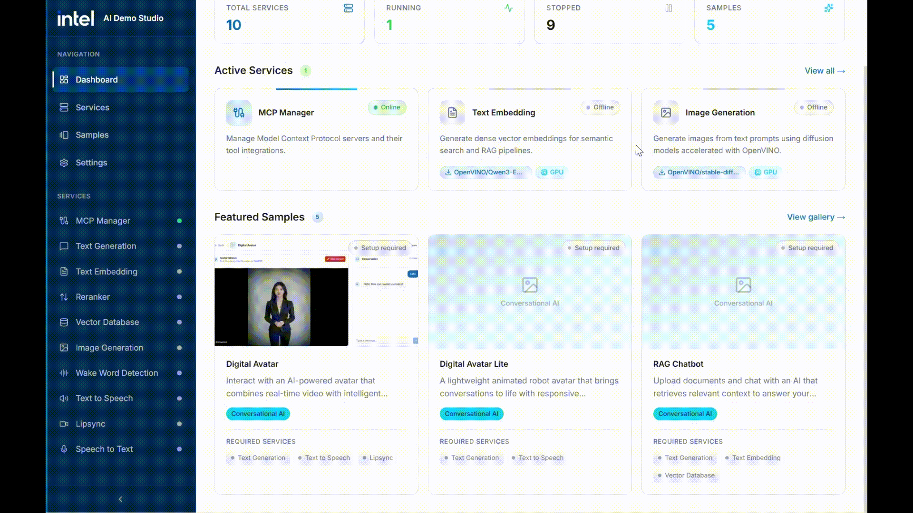
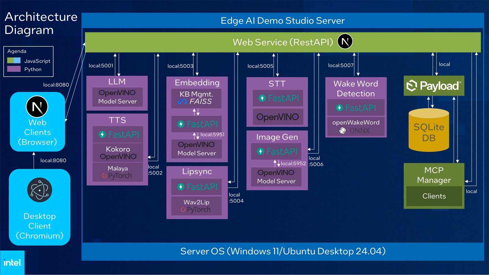

# Edge AI Demo Studio

Edge AI Demo Studio is a modern toolkit for deploying, managing, and serving AI models on edge platforms. It features a web-based UI for device, workload, and user management, and is optimized for Intel hardware and edge environments.



## Features

- **Easy Model Deployment:** Download, convert, and serve Hugging Face models with minimal setup.
- **Web-Based Management:** Manage devices, workloads, and users through a modern web interface.
- **Edge Optimized:** Built for Intel hardware and edge environments.
- **AI Services:** AI Services that users can use for their applications
  - **Text Generation** — Generate coherent text using large language models optimized for Intel hardware, served by OpenVINO Model Server or llama.cpp.
  - **Text to Speech** — Natural-sounding speech synthesis with multiple voice options powered by Kokoro, Piper, Malaya (Malay), Pocket TTS (Indonesian), VieNeu-TTS (Vietnamese), FastSpeech2 HS (Tamil) and SpeechT5 from the Open Edge Platform text-to-speech microservice.
  - **Speech to Text** — Real-time speech recognition with low-latency transcription using Whisper and Qwen3-ASR models optimized for Intel hardware, including live transcription from the microphone.
  - **Speaker Diarization** — Identify and label speakers in audio recordings using pyannote.audio speaker diarization models.
  - **Wake Word Detection** — Detect custom wake words from microphone input and send webhook notifications on detection events.
  - **Text Embedding** — Generate dense vector embeddings for semantic search and RAG pipelines, with optional image embeddings through the Open Edge Platform multimodal models.
  - **Reranker** — Rescore and rerank documents by relevance for improved search and RAG pipelines.
  - **Vector Database** — Vector storage for knowledge base management, semantic search, and RAG pipelines, backed by FAISS or PostgreSQL + pgvector.
  - **OCR** — Optical character recognition — extract text and its location from images using OCR models on OpenVINO.
  - **Face Recognition** — Detect and identify faces against a reference gallery using Open Model Zoo or OpenCV Zoo pipelines.
  - **Image Generation** — Generate images from text prompts using diffusion models accelerated with OpenVINO.
  - **Lipsync** — Real-time avatar lip-syncing with Wav2Lip or MuseTalk, streamed over WebRTC.
  - **Frame Generation** — RIFE video frame interpolation: fill in-between frames or raise a video's frame rate. The Digital Avatar sample uses it for smoother lipsync video on slower devices.
  - **MCP Manager** — Manage Model Context Protocol servers and their tool integrations.
- **Samples:** Sample use cases that implement the AI services (see [Exporting Samples & Services](#exporting-samples--services) to package a subset for standalone deployment)
  - **Digital Avatar** — Interact with an AI-powered avatar that combines real-time video with intelligent conversation.
  - **Digital Avatar Lite** — A lightweight animated robot avatar that brings conversations to life with responsive movements and expressions.
  - **RAG Chatbot** — Upload documents and chat with an AI that retrieves relevant context to answer your questions.
  - **Medical Scribe** — Automatically transcribe and diarize doctor-patient conversations, then generate structured SOAP notes.
  - **Webcam Capture with VLM** — Demonstrate the integration of webcam capture and Visual Language Model (VLM) for enhanced interaction.
  - **[AI Exam Marking](./frontend/src/samples/ai-exam-marking/README.md)** — AI-powered exam marking using OCR and LLM to automatically grade test papers from images.
  - **PowerPoint Translator** — Translate PowerPoint presentations while preserving formatting using AI.
  - **[Geti Image Classification](./frontend/src/samples/geti-classifier/README.md)** — Classify images using a local Intel Geti deployment and send feedback for continuous model improvement. *Linux only.*
  - **Synthetic Image Generation** — Generate and edit synthetic images from base images in real-time for dataset augmentation. *Linux only; needs an Intel GPU (XPU), and Arc A770 and lower A-series GPUs are not supported.*
  - **Robotics AI** — A demo showcasing the capabilities of Robotics AI, including real-time object detection and manipulation. *Linux only.*
- **Suites:** Curated industry-specific AI solution packages built on Intel Edge AI Suites, run as Docker Compose stacks. *Linux only.*
  - [*Manufacturing AI Suite*](https://github.com/open-edge-platform/edge-ai-suites/tree/main/manufacturing-ai-suite) — A comprehensive toolkit for building, deploying, and scaling AI applications in industrial environments. Enables real-time integration with optimized hardware for production workflow automation, workplace safety, defect detection, and asset tracking.
    - [**Pallet Defect Detection**](https://github.com/open-edge-platform/edge-ai-suites/tree/main/manufacturing-ai-suite/industrial-edge-insights-vision) — Real-time pallet condition monitoring on warehouse video streams using DL Streamer Pipeline Server, OpenVINO inference, and WebRTC streaming.
  - [*Metro AI Suite*](https://github.com/open-edge-platform/edge-ai-suites/tree/main/metro-ai-suite) — Accelerates application development for edge AI video safety, security, and smart city use cases. Includes OpenVINO™ toolkit, Deep Learning Streamer, and Intel® oneAPI Toolkit for media analytics and AI performance optimization.
    - [**Image-Based Video Search**](https://github.com/open-edge-platform/edge-ai-suites/tree/main/metro-ai-suite/image-based-video-search) — Near real-time image-based similarity search over live video streams using YOLOv11 object detection, ResNet-50 feature extraction via DL Streamer, and Milvus vector indexing.
  - [*Retail AI Suite*](https://github.com/open-edge-platform/edge-ai-suites/tree/main/retail-ai-suite) — Accelerates development of edge AI applications for retail environments, enabling intelligent automation for use cases such as self-checkout, loss prevention, and store analytics with optimized Intel hardware and the OpenVINO™ toolkit.
    - [**Loss Prevention**](https://github.com/intel-retail/loss-prevention/tree/main) — Real-time self-checkout loss prevention: detects and classifies retail products with YOLO11n object detection and EfficientNet-B0 classification to spot mis-scans and suspicious activity at the point of sale.

## Architecture Diagram


## Software Requirements

- **Operating System:**
  - Ubuntu 24.04 LTS (other Linux distributions may work, but are not officially supported)
  - Windows 11 24H1 (other versions may work, but this is the validated version)
- **Other:** See [install_dependencies.sh](install_dependencies.sh) for required system packages.

---


## Quick Start

### 1. Install System Dependencies (Linux only)

```bash
sudo ./install_dependencies.sh
```

This installs the system packages and the GPU/NPU drivers. Both
llama.cpp backends need nothing more from it: the Intel® oneAPI Toolkit is not
required for SYCL. Run `sudo ./install_dependencies.sh --help` for all options,
or see [Unattended setup (CI)](docs/DEVELOPMENT.md#unattended-setup-ci).

### 2. Set Up Python & Node.js Dependencies

For Linux:
```bash
./setup.sh
```
For Windows (PowerShell/Command Prompt):
```bash
./setup_win.bat
```

This will:
- Set up the shared worker Python environment and common helper packages
- Install frontend dependencies
- Prepare shared tools such as uv and OVMS
- On Linux, build [qmassa](https://github.com/ulissesf/qmassa), which reads GPU
  usage, from source into `thirdparty/qmassa` (about a minute, once; no sudo)

Service and sample dependencies and OEP source files are prepared when you start
the corresponding item in the UI. The first start can take longer while its
packages and assets are downloaded.

On Linux it also asks which llama.cpp backend the multiserve LLM engine should
use — `sycl` (best on Intel Arc / Xe GPUs) or `vulkan` (any Vulkan GPU) — and
downloads the matching llama.cpp build. For SYCL it also installs the Intel SYCL
runtime from Python wheels into the shared worker environment (`workers/.venv`,
about 0.3 GB on top of the libraries PyTorch XPU already put there) instead of
the multi-GB oneAPI Toolkit. The answer is saved to
`workers/engines/multiserve/.llamacpp-backend`, and the engine's own
`start.sh` applies it (for SYCL, putting that runtime on `LD_LIBRARY_PATH`)
every time the engine is started or restarted.

Re-run `./setup.sh` any time to switch backends; the previously chosen one is
offered as the default and the llama.cpp build you are switching away from is
removed. To skip the prompt:

```bash
./setup.sh --backend sycl     # or: --backend vulkan
```

Non-interactive runs (CI, Docker) keep the existing selection, or default to
`vulkan` when there is none. Run `./setup.sh --help` for all options, or see
[Unattended setup (CI)](docs/DEVELOPMENT.md#unattended-setup-ci).

#### Desktop app

The Electron app asks the same question with a native dialog on first launch,
before it installs anything. It writes the same selection file the CLI uses, so
both entry points stay in sync.

To change the backend afterwards, relaunch the app with `--reconfigure`; that
re-shows the dialog and swaps in the matching llama.cpp build.

---

### 3. Start the App
For Linux:
```bash
./start.sh
```
For Windows (PowerShell/Command Prompt):
```bash
./start_win.bat
```

Once started, access the web UI at [http://127.0.0.1:8080](http://127.0.0.1:8080).

---

## Preset Services with `deployment.json` (Optional)

By default, every service is created with its built-in defaults and stays stopped until you add and start it from the web UI. To define the setup in a file instead — which services and instances run, their model and accelerator (device), and which auto-start when the app boots — copy [deployment.example.json](deployment.example.json) to `deployment.json` in the project root (next to `setup.sh`) and edit it, or save the current setup from **Settings → Save current deployment**. The repository ships no `deployment.json`, and without one nothing is applied:

```json
{
  "$schema": "./docs/deployment.schema.json",
  "services": {
    "text-generation": [
      {
        "status": "online",
        "models": {
          "default": {
            "name": "OpenVINO/Qwen3.5-4B-int4-ov",
            "device": "GPU",
            "backend": "openvino"
          }
        }
      }
    ],
    "speech-to-text": [
      { "status": "online", "models": { "default": { "device": "NPU" } } }
    ]
  }
}
```

When `deployment.json` exists it is the whole setup, applied on every startup: the listed services get exactly the listed instances — a service nobody added is added from its defaults, with your presets written over them — and **everything else is removed** — an unlisted instance is deleted (with its data directory) and an unlisted service goes back to not added. Changes made in the UI therefore last until the next start unless you save the deployment again. Services with `"status": "online"` are started automatically (they move to `prepare` and are promoted to `active` once their health check passes); everything else stays offline.

Each service lists its instances, first instance first. The first entry configures the instance created with the app. Services that support multiple instances (most visible ones) can list more; every entry after the first needs a `label`. An entry is found again on each boot by its `instanceId` when it has one (saved deployments write it), else by its `label`: the matching instance is updated, a missing one is created as a copy of the first instance with the given overrides, and instances not listed are deleted. Renaming an entry that has an `instanceId`, or the first entry (which otherwise takes the oldest instance left), renames that instance and keeps its address; renaming a later entry without an id replaces that instance — a new one is created under the new name and the old one is deleted with its data. Two entries always mean two instances:

```json
{
  "services": {
    "text-generation": [
      { "label": "Text Generation", "status": "online", "models": { "default": { "device": "GPU" } } },
      { "label": "CPU fallback", "status": "online", "models": { "default": { "device": "CPU" } } }
    ]
  }
}
```

Every instance answers at `/api/<type>@<instance id>`. The id is derived from the name when the instance is created — here `/api/text-generation@text-generation` and `/api/text-generation@cpu-fallback` — and never changes afterwards, even when the instance is renamed; there is no bare `/api/text-generation`. Ports are never set in the file: every instance gets a free port from `INSTANCE_PORT_RANGE` when it starts. **Settings → Save current deployment** writes this file from what is configured now, names and instance ids included. Files in the older form (`"text-generation": { …, "instances": { "<id>": { … } } }`) are still read, with the same removal of anything they do not declare.

The Electron packaging scripts (`scripts/bash/package.sh` / `scripts/win/package.ps1`) bundle the project-root `deployment.json` into the package, so presets set before packaging ship with the app. In a packaged build the file lives at `resources/deployment.json` (next to the bundled frontend) — edit it there and restart the app to change the presets of an existing package, or point the `DEPLOYMENT_CONFIG_PATH` environment variable at a file elsewhere. See [docs/deployment-config.md](docs/deployment-config.md#packaged-electron-builds) for details.

You can also generate the file from a running instance: open **Settings → Deployment → Save current deployment…** in the web UI to snapshot every service's current configuration (running services are marked `"online"`), then download it or save it directly to the location the app reads on startup.

See [docs/deployment-config.md](docs/deployment-config.md) for the full JSON guidelines — all supported fields plus each service's available models, devices, and engines. The reference (and the [docs/deployment.schema.json](docs/deployment.schema.json) editor schema referenced via `$schema` above) is auto-generated from the service registry, so it always matches the version you are running.

---

## Exporting Samples & Services

The **Export Bundle** feature (`scripts/export-bundle.mjs`) lets you produce a slim, self-contained copy of Demo Studio that contains only the sample(s) and/or service(s) you select, together with the services and workers they depend on. You can export samples (their services are resolved automatically), specific services on their own with no samples at all, or a mix of both. The exported directory includes its own `setup.sh` / `setup_win.bat` and `start.sh` / `start_win.bat` scripts so it can be set up and run independently.

### Via the Launcher Script

Run from the repository root — Node.js is bootstrapped automatically from `thirdparty/` if not already installed. The script lists all available samples and services, lets you pick any combination by number (leave a prompt blank to skip that category — e.g. pick only services for a samples-free export), then prompts for output directory, optional dependencies, and dry-run preference.

For Linux:
```bash
./export.sh
```

For Windows (PowerShell/Command Prompt):
```bat
.\export.bat
```

Arguments are forwarded to `scripts/export-bundle.mjs` for non-interactive use:

```bash
./export.sh --samples=rag-chatbot                    # sample + its service deps
./export.sh --services=text-to-speech,ocr            # services only, no samples
./export.sh --samples=rag-chatbot --services=ocr     # mix of both
./export.sh --list                                   # list available ids
./export.sh --samples=rag-chatbot --dry-run          # preview the plan only
```

### Via the Frontend GUI

1. Open the web UI and navigate to the **Samples** page (`http://127.0.0.1:8080/samples`).
2. Click **Select to export** (top-right area of the page) to enter selection mode.
3. Check the sample card(s) you want to export.
4. Click the **Export selected** button (download icon) that appears in the selection toolbar.
5. Review the resolved export plan in the dialog — it lists the required services, any optional services (toggle **Include optional services** on/off), and the workers that will be bundled.
6. Click **Export** to download a `.zip` archive of the self-contained project.

---

### Docker

See [docker/README.md](docker/README.md) for docker guidelines.

---


## Project Structure

```
applications.ai.tools.edge-ai-demo-studio/
├── electron/         # Electron app
├── frontend/         # Next.js web frontend
├── workers/          # Python/AI backend services
├── models/           # Downloaded/converted models
├── scripts/          # Utility scripts
├── install_dependencies.sh  # System dependency installer
├── setup.sh / setup.ps1     # Project setup scripts
└── README.md
```

---


## Deployment

The app is deployed using Electron to package the application.
See [docs/DEPLOYMENT.md](docs/DEPLOYMENT.md) for deployment guidelines.

---


## FAQ

**Q: Why is Electron Skipped by default**

This is because Electron is being used to create a packaged release only. If you need a packaged release, please refer to [docs/DEPLOYMENT.md](docs/DEPLOYMENT.md)

**Q: Unable to Start Text Generation service (possibly due to Long Paths Issue) on Windows**

The model could not be downloaded because the path is too long, causing the service to fail to start. Move the `edge-ai-demo-studio` project folder to a shorter path (e.g. `C:\edge-ai-demo-studio`) and try again.

**Q: Unable to start Speech-to-Text service (or other services) on Windows**

If you are behind a private/corporate network, check whether `NO_PROXY` is set in the terminal (CMD prompt/PowerShell) that you start Edge AI Demo Studio from, e.g.:

```powershell
echo %NO_PROXY%
```

or in PowerShell:

```powershell
echo $env:NO_PROXY
```

The terminal may not have picked up a `NO_PROXY` value that was set via the GUI (Settings > Network & internet > Proxy). Try setting `NO_PROXY` directly in the same terminal session before starting Edge AI Demo Studio:

- CMD prompt (session-only):

  ```cmd
  set NO_PROXY=localhost,127.0.0.1
  ```

- PowerShell (session-only):

  ```powershell
  $env:NO_PROXY = "localhost,127.0.0.1"
  ```

---


## Changelog

Every user-facing pull request merged into `main` — features, fixes, performance changes; not chores, docs, CI or tests — gets an entry here, written by GitHub Copilot from the pull request and grouped the [Keep a Changelog](https://keepachangelog.com/en/1.1.0/) way. Entries collect on the open `docs: update changelog` pull request until it is merged, and a release moves them under its version. See [docs/CI-CD.md](docs/CI-CD.md#6-changelog) for how it works.

<!-- changelog:start -->

### Unreleased

#### Added

- Multiple model instances per service, running as a background daemon, new Pocket TTS, VieNeu-TTS and Vector Database services, plus a redesigned dashboard and services catalog. (#704) <!-- pr:704 -->

<!-- changelog:end -->
