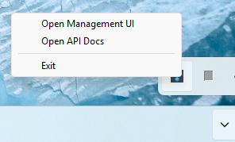
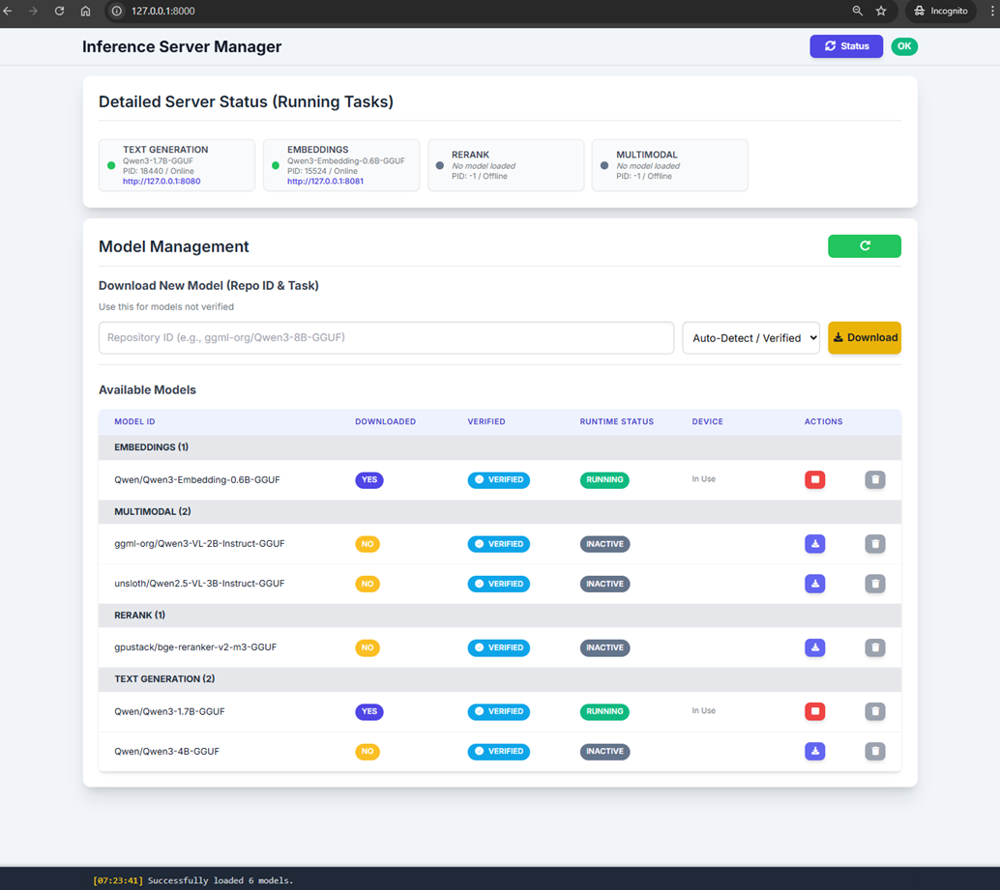
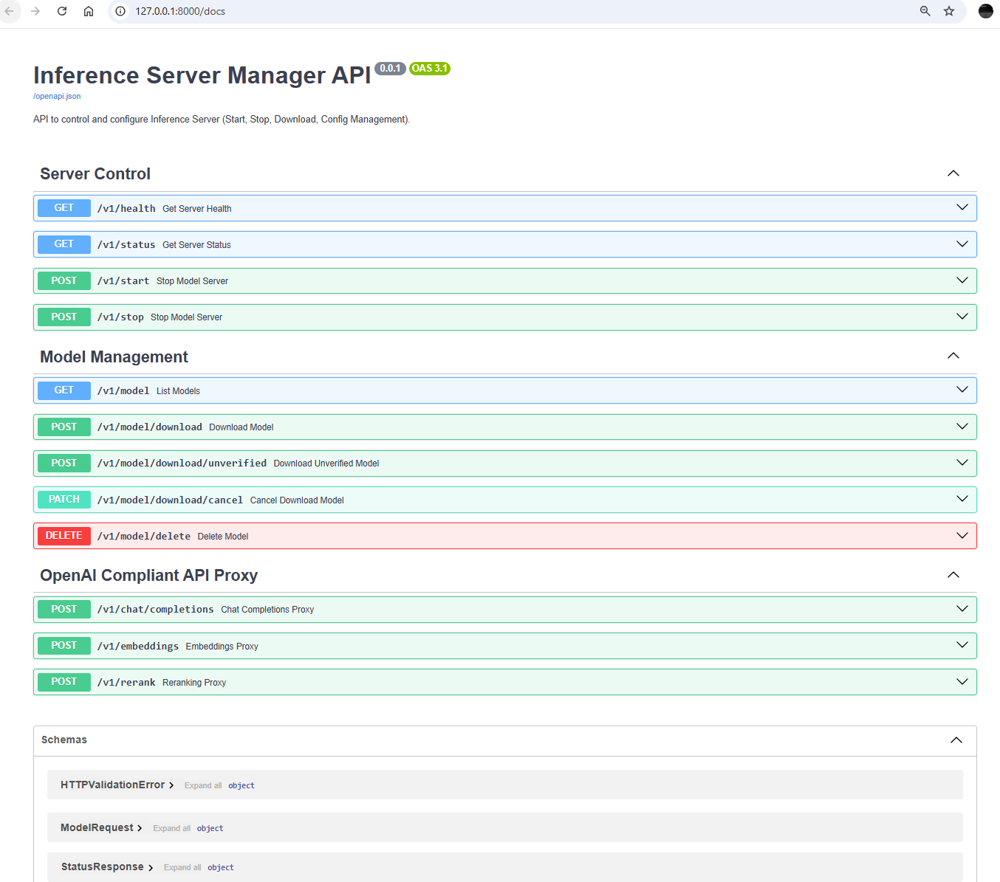

<!-- filepath: c:\Users\user\applications.ai.multiserve\README.md -->
# Multi-Backend Inference Server

A unified, local inference server for managing, running, and monitoring multiple LLM backends (Llama.cpp, OpenAI-compatible APIs, and more) with a modern web dashboard and tray integration.

## Features

- **Model Management**: Download, verify, start, stop, and delete LLM models from Hugging Face or manually.
- **Multi-Task Support**: Supports text generation, embeddings, reranking, and multimodal models.
- **Device Selection**: Run models on CPU, GPU, or NPU (if supported).
- **Web Dashboard**: Modern UI for status, logs, and model management.
- **Tray App**: System tray integration for quick access and server control.
- **OpenAI Proxy**: Exposes OpenAI-compatible endpoints for easy integration.
- **Cross-Platform**: Windows and Linux support.

## Directory Structure

```
.
├── app.py                  # Main FastAPI application entrypoint
├── modules/                # Core Python modules
│   ├── llamacpp/           # Llama.cpp management and GGUF downloader
│   ├── ovms/               # OpenVINO Model Server (OVMS) backend management   
│   ├── tray_app.py         # System tray integration
│   └── utils.py            # Utility functions
├── routers/                # FastAPI routers (API endpoints)
├── engine/                 # Native binaries, licenses, and XPU headers
├── static/                 # Web dashboard static files
├── tests/                  # Example tests
├── config.yaml             # Model/task configuration
├── verified.yaml           # List of verified models
├── pyproject.toml          # Python dependencies
├── app-vulkan.spec         # PyInstaller spec for building executable
└── README.md               # This file
```

## Prerequisites

- **Git**: Install via winget:
  ```sh
  winget install --id Git.Git -e --source winget
  ```

- **Python 3.12**: Install via winget:
  ```sh
  winget install Python.Python.3.12 --source winget
  ```

- **MS VC Redist**: Install via winget:
  ```sh
  winget install --id Microsoft.VCRedist.2015+.x64 --source winget
  ```
  
## Quick Start

1. **Clone the repository and run setup**

   ```sh
   git clone <repository-url>
   cd applications.ai.multiserve
   setup.bat
   ```

2. **Set the backend**

   Choose your desired backend by setting the environment variable:

   ```sh
   # For LlamaCPP backend
   set MULTISERVE_BACKEND=llamacpp

   # For OVMS backend
   set MULTISERVE_BACKEND=ovms
   ```

3. **Run the server in headless mode**

   ```sh
   uv run app.py --headless
   ```

4. **Access the dashboard**  
   Open [http://127.0.0.1:9090](http://127.0.0.1:9090) in your browser.

## Building a Standalone Executable

1. **Build the executable (Only support llamacpp)**

   ```sh
   pyinstaller app-vulkan.spec
   ```

2. **Run the standalone executable**

   ```sh
   C:\Users\user\applications.ai.multiserve\dist\InferenceServerManager-Vulkan.exe --headless
   ```

## Model Management

- **Download**: Use the dashboard or API to download models by Hugging Face repo ID.
- **Start/Stop**: Start or stop models for different tasks (text generation, embeddings, rerank, multimodal).
- **Device Selection**: Choose CPU/GPU/NPU for inference (if available).
- **Logs**: View download and runtime logs in the dashboard.

## Model Catalogue CLI

`list_models.py` prints the same catalogue as `GET /v1/models` — the verified
list from `verified.yaml` merged with what is actually on disk — without
starting the server, the tray, or anything else. It reuses the engine's own
`OVDownloader`/`GGUFDownloader` classes (see `modules/ovms/ov_downloader.py`
and `modules/llamacpp/gguf_downloader.py`) directly, so it stays equivalent
to the live endpoint, though not byte-for-byte: on a backend that fails to
list, the script still emits that backend's key as `[]` plus an entry in a
top-level `warnings` array, where the router (`routers/main_proxy_router.py`'s
`get_all_models`) just omits the key entirely; `--provider` is matched
case-sensitively here (`argparse`'s `choices=`) and rejects an unrecognised
value outright, where the router lower-cases it before comparing and
silently returns nothing for a provider it doesn't recognise. It exists so a
caller (the frontend, in particular) can show model state — what's
verified, what's already downloaded — for an engine instance that isn't
running yet or is stopped.

```sh
python list_models.py --model-dir <dir> [--provider openvino|llamacpp]
```

`--model-dir` is the same directory an engine instance is started with
(`app-hybrid.py --model-dir`); this script looks for `OV/` and `GGUF/`
underneath it, exactly as `app-hybrid.py` does. `--provider` restricts the
output to one backend; omitting it returns both, keyed `openvino`/`llamacpp`,
matching the router's own `provider` filter. The command always exits `0` and
prints nothing but the final JSON document to stdout: a missing model
directory simply reports nothing downloaded, and a backend that fails to
load (e.g. a broken `verified.yaml`) comes back as an empty list for that
key plus an entry in a top-level `warnings` array — it never aborts the
other backend's listing. All diagnostics go to stderr.

## Ports

The engine listens on one port, `--port` (default 9090), and that is the only
port an engine instance takes. The model servers it starts bind no fixed
offsets from it: each llama-server (one per task) and the OpenVINO Model
Server get a free loopback port of the operating system's choosing when they
start (`pick_free_loopback_port` in `modules/utils.py`; a port another process
grabs in the moment before the server binds it is retried on a new one), and
the engine proxies every request to them. `GET /v1/status` lists each running
server with its `url`. Nothing but the engine should dial those ports: they
change on every start. The OpenVINO Model Server is started with the first
OpenVINO model (`POST /v1/start`), not with the engine, so an instance that
serves only GGUF models runs no OVMS at all; `GET /v1/health` reports whether
each backend is ready to start a model, not whether its server is running.

## API Endpoints

- **/v1/model**: List available/downloaded models
- **/v1/start**: Start or swap a model
- **/v1/stop**: Stop a running model
- **/v1/download**: Download a model
- **/v1/delete**: Delete a model
- **/v1/status**: Get server and model status
- **/v1/chat/completions**: OpenAI-compatible endpoints
- **/v1/embeddings**: OpenAI-compatible endpoints
- **/v1/rerank**: OpenAI-compatible endpoints

## Extra server arguments

`POST /v1/start` takes extra arguments for the model server, as a list or as
one shell-quoted string. The studio sends an instance's Runtime Settings →
Advanced → Server Arguments (`metadata.serverArgs`):

- **`llamacpp_extra_args`**: llama-server flags. A flag given here replaces
  the engine's own value for it, in any spelling (`-c` and `--ctx-size`,
  `--reasoning_format` and `--reasoning-format`). Repeatable flags such as
  `--lora` stay repeated. A start with arguments that differ from the running
  server's restarts it.
- **`openvino_extra_params`**: `ovms --pull` graph options for the model's
  task (`--max_num_seqs`, `--cache_size`, `--num_streams`, ...). The engine
  pulls the model again on every start, which rewrites its `graph.pbtxt` with
  them. A pull that rejects them fails the start with OVMS's reason, instead
  of serving the old graph. A `--plugin_config` is merged with the pinned CPU
  thread count; a `--tool_parser`, `--pooling` or `--pipeline_type` replaces
  the engine's own.

Flags the engine sets itself are refused with HTTP 400:
`modules/extra_args.py` lists them (the port, host and model of llama-server;
the model, repository, task and device of `ovms --pull`).

## Configuration

- **config.yaml**: Controls active models and default parameters.
- **verified.yaml**: List of models considered "verified" for auto-discovery.

## Model upload and download streams

- **Upload**: `POST /v1/model/upload` takes the whole model in one multipart
  request. Large models go through `POST /v1/model/upload/chunk` instead, one
  chunk per request (`chunk_index`, `total_chunks`, optional `total_size`,
  `upload_id`, `relative_path`, `commit`); chunks may be retried or arrive out
  of order, and `DELETE /v1/model/upload/chunk` drops a staged upload. The
  full contract is documented in `routers/utils.py`.
- **GGUF uploads** (`repo_id` `llamacpp:<Org>/<Model Name>[:<QUANT>]`) are one
  `.gguf` file, stored under its own name in `<task>/<Org>/<Model Name>/` --
  the same folder downloads use, beside the repo's other quants. The quant is
  never part of a path (Windows allows no `:` in file or folder names): the
  model id is `<Org>/<Model Name>:<QUANT>`, recorded in `GGUF/user_uploads.json`
  (id → file name). Leave `:<QUANT>` off and it is taken from the file name
  (`model-Q4_K_M.gguf`); a quant in both that disagrees, or none in either, is
  refused with 422 before anything is written. A file of the same name is a
  409 unless `force_override`, and so is an id already uploaded as another
  file. Start and stop use the model id. At start-up the engine moves files
  out of the `<Model Name>:<QUANT>/` folders older versions created into this
  layout and registers them (a name already taken stays put, with a warning).
- **Delete** (`DELETE /v1/model/delete`): `llamacpp:<Org>/<Model Name>:<QUANT>`
  deletes that one quant -- the upload registered under the id, else the
  files of the tag's cached manifest, else local GGUFs whose name carries the
  quant, else the files of the hub's manifest; a multimodal projector stays
  while another quant still needs it. `llamacpp:<Org>/<Model Name>` deletes
  the whole repo: every upload and every download with a cached manifest,
  then the files of the hub's `latest` manifest if GGUFs remain. A model
  being served is stopped first (llama.cpp) or taken out of the OVMS config
  and waited on until the server has unloaded it (OpenVINO), since Windows
  cannot delete open files.
- **Names**: ids, tags and file names that become paths are refused (400/422)
  when Windows could not hold them: `<>:"|?*`, control characters, a trailing
  dot or space, or a reserved device name such as `CON`, `NUL` or `COM1`.
- **Download**: the `POST /v1/model/download*` streams always end with one
  `DOWNLOAD_RESULT {"ok": true}` or `DOWNLOAD_RESULT {"ok": false, "error": "..."}`
  line; decide success from it, not from the progress text. Long silent
  phases (hashing, conversion) print a status line every 20 s.
- **Chat errors**: `/v1/chat/completions` answers an upstream failure with the
  upstream status and an OpenAI-shaped `{"error": {"message", "type", "code"}}`
  body; a failure after a stream has started arrives as one
  `data: {"error": {...}}` event.

## Testing

The project includes comprehensive smoke tests for both backends (LlamaCPP and OVMS). Tests are organized into tiers:

- **Tier 1 (Safe)**: Read-only operations (always enabled)
- **Tier 2**: Download verified models
- **Tier 3**: Test all verified models (start/API/stop)
- **Tier 4**: Additional API operations (download unverified, cancel, delete)
- **Tier 5**: OpenAI-compatible API tests
- **Tier 6**: Model upload tests

### Running Tests

**For LlamaCPP backend:**

```sh
cd tests\smoke_test_pytest
test_llamacpp.bat
```

You'll be prompted to enter the path to a GGUF file for upload testing (optional).

**For OVMS backend:**

```sh
cd tests\smoke_test_pytest
test_ovms.bat
```

You'll be prompted to enter the path to an OpenVINO model folder for upload testing (optional).

### Test Configuration

Control which test tiers to run via environment variables in the batch scripts:

```sh
# Enable all tiers (set to 1 to enable, 0 to disable)
set LLAMACPP_TEST_DOWNLOAD_VERIFIED=1
set LLAMACPP_TEST_VERIFIED_MODELS=1
set LLAMACPP_TEST_ADDITIONAL_API=1
set LLAMACPP_TEST_OPENAI_API=1
set LLAMACPP_TEST_UPLOAD=1
```

## Building a Standalone App

This project supports PyInstaller for packaging as a standalone executable. See [app.spec](app.spec) for build configuration.

## Running the App

App will launched in tray mode



Click the **Open Management UI** will launch the dashboard in browser



Click the **Open API Docs** will launch the Swagger API docs in browser



---