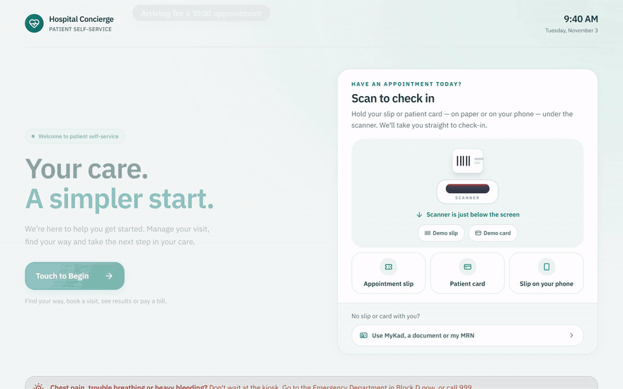
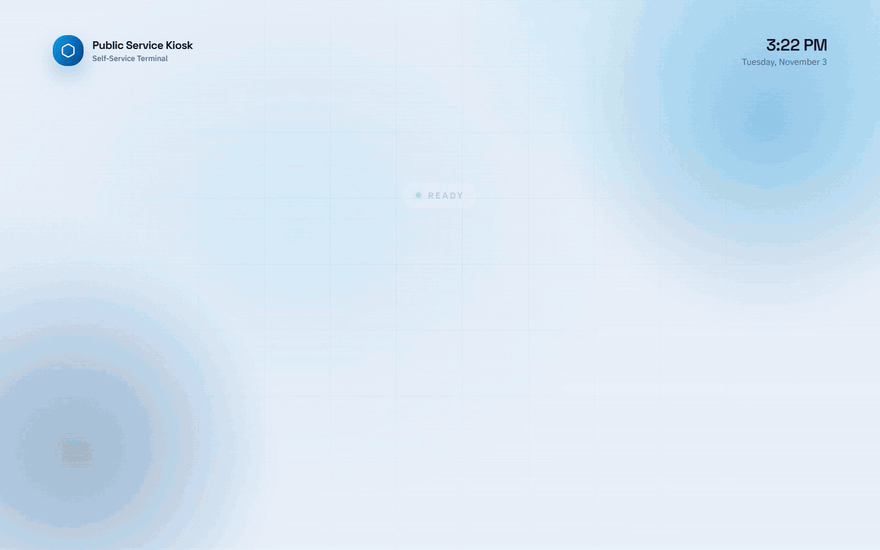

# Vertical Reference Solutions Blueprint

A kiosk kit for building self-service terminals on Edge AI — identity
verification, document capture and AI-assisted service flows, running on
local hardware. `common/` holds the shared tooling; each vertical is its own
kiosk with its own frontend.

## Demo

**Healthcare**: a patient signs in with their MyKad and a face match, checks in
for today's appointment, and gets a queue number and the way to the clinic.



**Public service**: a citizen applies for a Certificate of Good Conduct:
consent, MyKad and a face match, the purpose, two documents checked against
the ID, a card payment and the receipt.



Both are the touch kiosk with nothing live behind it: the AI is mocked, the
card reader and scanners are simulated, and the camera is a drawn stand-in.
To record them again, see each kiosk's tests README
([healthcare](healthcare-service-kiosk/frontend/tests/README.md#demo-recording),
[public service](public-service-kiosk/frontend/tests/README.md#demo-recording)).

## Layout

| Path | What |
|---|---|
| [common/](common/) | Shared tooling: launcher scripts, Electron desktop shell, studio bundler, kit docs. Drives the kiosks you chose at setup. |
| [public-service-kiosk/](public-service-kiosk/) | The Public Service Operational Efficiency Kiosk, for civic services: `frontend/` (Next.js app with its 10 services), `kiosk.json`, `deployment.json`, `scripts/` (launchers). |
| [healthcare-service-kiosk/](healthcare-service-kiosk/) | The hospital concierge kiosk: `frontend/` (Next.js app with the 19 services of [service-hierarchy.xlsx](healthcare-service-kiosk/docs/service-hierarchy.xlsx)), `kiosk.json`, `deployment.json`, `scripts/` (launchers), [docs/](healthcare-service-kiosk/docs/). |

Each kiosk folder has the same shape: `frontend/` (the app), `kiosk.json`
(product name, app id, local port, studio sample id and port), `deployment.json` (the
Edge AI Studio services each terminal mode runs — see [getting started](common/docs/getting-started.md#the-edge-ai-studio-prerequisite)),
and `scripts/`: `setup.sh`, `start.sh` and `uninstall.sh` (plus `_win.bat`
twins) that forward to `common/` with that kiosk selected.

Each kiosk is self-contained: its `frontend/` has its own `package.json`,
lockfile and `node_modules`, and nothing is installed at the repo root.

## Getting started

```bash
./setup.sh           # one time: asks what to do (set up only, start, dev or build),
                     # which kiosks (public-service, healthcare or both) and whether the
                     # AI is live (Edge AI Studio) or mocked, installs them, then does it
./start.sh           # starts the studio and every kiosk you set up
./setup.sh --build   # packages every kiosk you set up as a desktop app, into build/
```

Flags answer setup's questions up front: `./setup.sh --start`, `--dev`
(one kiosk, hot reload) or `--build`, with `--kiosk <name|all>` and `--mock`.

No Edge AI Studio? Add `--mock`: the AI services are mocked and the hardware
is simulated, and no studio checkout is needed:

```bash
./setup.sh --build --mock     # one time: asks which kiosks, then packages each as a desktop app
./start.sh --desktop --mock   # opens them, side by side
```

(`./setup.sh --mock` then `./start.sh --mock` serves the same kiosks in the browser instead.)

`./setup.sh` remembers the choice (in `common/.kiosks`), and `./start.sh` and
`./uninstall.sh` follow it. Each kiosk serves on its own port,
so both can run side by side against one studio:

| Kiosk | URL |
|---|---|
| public-service | http://127.0.0.1:3000 |
| healthcare | http://127.0.0.1:3001 |

`--kiosk <public-service|healthcare|all>` overrides the choice: on `./setup.sh`
it changes what is set up (and saved), on the others it applies to that run
only (`./start.sh --kiosk healthcare --mock`). A kiosk folder's own scripts
(`healthcare-service-kiosk/scripts/start.sh`, …) always drive that kiosk alone. Packages and exported
bundles of every kiosk land in `build/` at the repo root (bundles in
`build/kiosk-studio/<kiosk>/`).

See [common/README.md](common/README.md) for every flag and the Windows
equivalents (`setup_win.bat`, `start_win.bat`, `uninstall_win.bat`).

## Documentation

- [common/README.md](common/README.md) — architecture, peripherals, commands
- [common/docs/](common/docs/) — setup, dev mode, build/packaging, configuration
  reference, country packs, i18n
- [common/docs/ci.md](common/docs/ci.md) — the manual CI workflow (setup, test run,
  Playwright suites)
- [healthcare-service-kiosk/README.md](healthcare-service-kiosk/README.md) — the healthcare kiosk's services

Licensed Apache-2.0 — every source file carries its own SPDX header.
