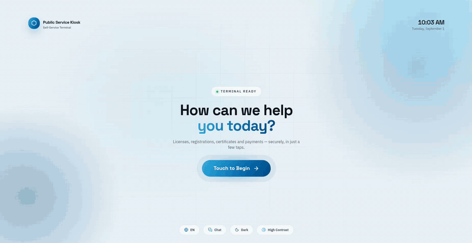

<div align="center">

# 🏛️ Vertical Reference Solutions Blueprint

**A vertical reference solutions blueprint for edge AI applications, shipping a sample
public-service kiosk — touch, chat and voice-agent terminals with identity
verification, document scanning and AI-powered service flows, running fully on
local hardware.**

[Getting Started](docs/getting-started.md) · [Dev Mode](docs/dev-mode.md) · [Build](docs/build.md) · [Configuration](docs/configuration.md) · [Release Notes](docs/release-notes.md)



<sub>The touch terminal, end to end — identity check, documents, payment, receipt.</sub>

</div>

---

## 🗂️ Kiosks

`common/` is the shared tooling — launchers, Electron shell, studio bundler, docs.
Each kiosk is a folder at the repo root with its own Next.js app and a `kiosk.json`
(product name, app id, studio sample id and port):

| Kiosk | Folder |
|---|---|
| Public service (civic) | `public-service-kiosk/` |
| Hospital concierge | `healthcare/` |

Paths written `<kiosk>/frontend/` in these docs mean the chosen kiosk's app.
`./setup.sh` asks which kiosks to set up — one, the other or both — and saves
the answer in `common/.kiosks`; the root `./start.sh` and `./uninstall.sh`
(and `./setup.sh --build`) then act on every kiosk in it. `--kiosk <names|all>` picks
kiosks by `kiosk.json` id or folder name (`public-service`, `healthcare`,
comma separated): on setup it changes the saved choice, on the others it
applies to that run only. Each kiosk folder carries its own `scripts/`
with `setup.sh`, `start.sh` and `uninstall.sh` (and `_win.bat` twins) that
always drive that kiosk alone:

```bash
./start.sh --kiosk healthcare --mock        # this run only
healthcare/scripts/start.sh --mock          # same, through the kiosk's own launcher
```

One studio serves every kiosk; with both selected it gets the deployment
profile of the more demanding one (chat beats touch). Each kiosk has its own
port (`kiosk.json` `"port"`): public-service on **3000**, healthcare on **3001**.

## ⚡ Quick start

```bash
./setup.sh           # one time: asks what to do (set up only, start, dev, build), which
                     # kiosks and live or mocked AI, installs, then does it
./start.sh           # builds (if needed) and serves each kiosk on its own port
./setup.sh --build   # packages each kiosk as a desktop app, into build/
```

On Windows, run the `_win.bat` of the same name — the suffix keeps them apart
from the `.sh` scripts when Explorer hides file extensions. Each one launches
the matching `common\scripts\win\*.ps1` with the execution policy bypassed for that
process only:

```bat
setup_win.bat
start_win.bat
setup_win.bat --build
```

Both scripts expect the **Edge AI Studio** (the AI gateway) checkout at
`EDGE_AI_STUDIO_DIR` and fail if it is missing: setup sets it up (long: models,
toolchains), start launches it and waits for its gateway. Skip it on a terminal that
talks to a gateway running elsewhere — the kiosk then uses whatever is live at
`STUDIO_URL` and reports the rest on its health page:

```bash
./setup.sh --skip-studio  # kiosk dependencies only
./start.sh --no-studio    # serve against whatever gateway is live
```

No AI gateway at all? Run everything mocked — no studio checkout needed:

```bash
./setup.sh --mock             # kiosk dependencies only
./start.sh --mock             # serve the kiosks with mocked AI

./setup.sh --build --mock     # or: one mocked desktop app per kiosk (build/*-mock.AppImage)
./start.sh --desktop --mock   # and open them, side by side
```

| Script | Windows | What it does | Doc |
|---|---|---|---|
| `./setup.sh` | `setup_win.bat` | One-time install: asks what to do afterwards (`--start`, `--dev`, `--build`), which kiosks (`--kiosk`) and live or mocked AI (`--mock`), then their frontend deps and the Edge AI Studio (`--skip-studio` to leave it out); optional peripheral drivers (`--hardware`) | [getting-started.md](docs/getting-started.md) |
| `./start.sh` | `start_win.bat` | Normal start: brings the Edge AI Studio gateway up (`--no-studio` to skip), then each kiosk's production server on its own port (3000, 3001); Ctrl+C stops them all | [getting-started.md](docs/getting-started.md) |
| `./common/scripts/dev/dev.sh --kiosk <name>` | `common\scripts\dev\dev.bat --kiosk <name>` | Development, one kiosk at a time on its own port: hot reload, `--mock` for zero-dependency UI work, `--desktop` for the desktop shell (`./setup.sh --dev` sets up first, then runs it) | [dev-mode.md](docs/dev-mode.md) |
| `./common/scripts/dev/update.sh` | `common\scripts\dev\update.bat` | Mirror this checkout into the release tree or another directory (non-gitignored files only, minus `.git`, `.claude`, `.github`, `.vscode`, `healthcare` and the update scripts) | [dev-mode.md](docs/dev-mode.md) |
| `./setup.sh --build` | `setup_win.bat --build` | Production build, one per kiosk: the embedded bundle as a desktop app (.AppImage/.deb on Linux, .exe/.msi on Windows) → `build/` at the repo root. Installs the kiosk deps, asks every kiosk's questions first, installs the `common/electron/` deps itself. `./common/scripts/build.sh` (`common\scripts\build.bat`) is the build alone, with `--kiosk` for one run | [build.md](docs/build.md) |
| `./uninstall.sh` | `uninstall_win.bat` | Remove the installed apps; `--data` also removes what they wrote (database, documents, unpacked platform) | [build.md](docs/build.md) |

Every script takes `--help`, and the flags are spelled the same on both platforms.

---

## ⭐ What's inside

A citizen walks up, verifies their identity (NFC ID card + face match), submits
documents (scanner, upload or mocks), pays, and gets a receipt — through one of three
terminal styles:

- **Touch** — classic guided screens
- **Chat** — conversational flow with voice in/out
- **Agent** — an LLM agent driving the kiosk's services over MCP

| Component | Path | Stack |
|---|---|---|
| Kiosk app (UI + API + admin) | `<kiosk>/frontend/` ([public-service](../public-service-kiosk/frontend/), [healthcare](../healthcare/frontend/)) | Next.js 16, React 19, Tailwind 4, Vercel AI SDK, MCP |
| Admin dashboard / citizen registry | `/admin` route | Payload CMS 3 on SQLite (auto-created & seeded with 100 synthetic citizens) |
| Staff registration desk | `/enroll` route | Enroll citizens, bind NFC cards, capture portraits |
| Settings page | `/settings` route | Edit this terminal's `config.yaml` in the browser and restart the kiosk to apply |
| Desktop shell | [electron/](electron/) | Electron — packages the server into a fullscreen AppImage/deb, running it on the shell's own Node |
| Country pack (Malaysia) | `<kiosk>/frontend/src/packs/malaysia/` ([public-service](../public-service-kiosk/frontend/src/packs/malaysia/), [healthcare](../healthcare/frontend/src/packs/malaysia/)) | Everything country-shaped: the folder-defined services (10 in public-service, 19 in healthcare) with their flow planners, ID documents & copy, speech vocabulary, public-service's NLU keywords — a second country is a sibling pack |
| Peripheral drivers | `<kiosk>/frontend/src/app/api/_lib/peripherals/` ([public-service](../public-service-kiosk/frontend/src/app/api/_lib/peripherals/), [healthcare](../healthcare/frontend/src/app/api/_lib/peripherals/)) | Driver contract + registry for NFC and the scanner; per-model scanner quirks are pluggable profiles |
| Mock data | `<kiosk>/assets/` (generated), `<kiosk>/frontend/data/` ([public-service](../public-service-kiosk/frontend/data/), [healthcare](../healthcare/frontend/data/)) | Synthetic citizens, ID cards, scannable documents |

### 🧠 The AI prerequisite: Edge AI Studio

All AI features are HTTP calls to the **Edge AI Demo Studio** gateway on
`localhost:8080` — LLM (text-generation), OCR (PaddleOCR), face recognition,
speech-to-text and text-to-speech. The launcher scripts build and start it for you,
and write its `deployment.json` from each kiosk's own `deployment.json`
([healthcare](../healthcare/deployment.json), [public service](../public-service-kiosk/deployment.json)),
which lists the studio services every terminal mode runs, with their model and
devices — `touch` runs OCR and face only, leaving text-generation to a **remote**
gateway that `llm.base_url` points at; `chat`/`agent` run all five locally
([details](docs/getting-started.md#the-edge-ai-studio-prerequisite)).
Its location is configurable:

```bash
# common/.kioskrc (gitignored) — or export as env vars
EDGE_AI_STUDIO_DIR="../../edge-ai-demo-studio"
```

See [getting-started.md](docs/getting-started.md#the-edge-ai-studio-prerequisite)
for making its services auto-start; its own `scripts/bash/package.sh` packages it
into a distributable executable.

---

## 📥 Installation

**Requirements:** Node.js ≥ 20 (or let `./setup.sh` fetch a portable one) · Linux (Debian/Ubuntu) or
Windows (every launcher has a `_win.bat` twin) · an [Edge AI Studio] checkout
(needed for live AI; without one, use `--mock`).

```bash
./setup.sh                   # standard: asks what to do, which kiosks, live or mocked AI
./setup.sh --start           # set up, then start the kiosks (./start.sh)
./setup.sh --dev --mock      # set up, then one kiosk in dev mode with mocked AI (common/scripts/dev/dev.sh --mock)
./setup.sh --kiosk all       # both kiosks, no question (or: --kiosk healthcare)
./setup.sh --yes             # non-interactive (the saved kiosk choice, else public-service)
./setup.sh --hardware        # + peripheral drivers: pcscd (NFC), SANE + PFU pfufs (scanner), poppler (OCR)
./setup.sh --package-studio  # + build the studio's distributable executable
./setup.sh --build           # kiosk dependencies, then the production build — the studio is not set up
```

The studio setup is for running the kiosk natively from this checkout. A build
machine only needs the studio *checkout* (the build exports the bundle from it),
so `--build` skips the studio setup unless you also pass `--studio`.

---

## 🖥️ Running

| Goal | Command |
|---|---|
| Run the kiosks (normal) | `./start.sh` · `start_win.bat` |
| Run one of them, this time | `./start.sh --kiosk healthcare` · `healthcare/scripts/start.sh` |
| Run the packaged desktop app | `./start.sh --desktop` · `start_win.bat --desktop` (one kiosk: add `--kiosk <name>` when both are set up) |
| Develop with hot reload | `common/scripts/dev/dev.sh --kiosk healthcare` · `common\scripts\dev\dev.bat --kiosk healthcare` · set up first: `./setup.sh --dev` |
| Desktop shell in dev mode | `common/scripts/dev/dev.sh --kiosk <name> --desktop` · `common\scripts\dev\dev.bat --kiosk <name> --desktop` |
| Package the kiosk apps (embedded bundle) | `./setup.sh --build` (non-interactive: `--yes -- --targets=appimage,deb`) · the build alone: `common/scripts/build.sh` |
| Package the kiosk apps on Windows | `setup_win.bat --build` (non-interactive: `--yes -- --targets=nsis`) · the build alone: `common\scripts\build.bat` |
| Run the bundle from the checkout | `./setup.sh --bundle` |
| Run the embedded bundle | `./start.sh --bundle` (add `--desktop` for a desktop window; one kiosk — `--kiosk <name>` or `<kiosk>/scripts/start.sh --bundle`) |
| Run without any AI gateway | `./start.sh --mock` / `common/scripts/dev/dev.sh --kiosk <name> --mock` |
| Desktop apps without any AI gateway | `./setup.sh --build --mock`, then `./start.sh --desktop --mock` (every kiosk at once; one at a time on Windows) |
| Uninstall an installed terminal | `./uninstall.sh --dry-run` then `./uninstall.sh [--data]` · `uninstall_win.bat` |

The embedded bundle (`--bundle`) is exported by `common/scripts/bundle.mjs`, one Node
script shared by both platforms (`common/scripts/bundle.sh` is its bash wrapper), so
`setup_win.bat --bundle` and `start_win.bat --bundle` work the same as their
bash counterparts.

**Live by default.** Every script sets up and runs the real stack — live AI services
via the studio, real scanner/NFC hardware. Mocks are used only when you
explicitly pass `--mock`; the `reference` profile does not simulate an absent
card reader or scanner either.

Key URLs once running (public-service; healthcare has the same on **:3001**, plus
`/staff` and `/queue`): kiosk **:3000**, admin **:3000/admin**
(`admin@demo.local`, with the password the launcher generated on first run and
printed — `cms.admin_password` in the gitignored `<kiosk>/frontend/config.yaml`), staff desk
**:3000/enroll**, settings **:3000/settings**, health **:3000/api/health**, studio
gateway **:8080**.

---

## 🔧 Configuration

Settings resolve as **env vars → `<kiosk>/frontend/config.local.yaml` → `<kiosk>/frontend/config.yaml`
→ code defaults**. `config.yaml` is this terminal's own, gitignored copy — the launchers
create it from the kiosk's `frontend/configs/` ([public-service](../public-service-kiosk/frontend/configs/),
[healthcare](../healthcare/frontend/configs/)) on the first run. The committed
`configs/reference.yaml` is the default profile; every option — AI endpoints, NFC reader, document scanner,
session timing, CMS credentials, prompt overrides, launcher variables — is documented in
**[docs/configuration.md](docs/configuration.md)**.

Every setting — terminal mode, document source and country pack included — is
read when the kiosk starts, so a change needs a restart, never a rebuild. See
[configuration.md § When a change takes effect](docs/configuration.md#when-a-change-takes-effect).

---

## 🌏 Country packs & localisation

The kiosk ships with a **Malaysia** pack, but nothing about a country is
hardwired: identity documents and what they are called, the on-screen and
spoken copy, the speech-recognition vocabulary, public-service's keyword
routing and the service catalog itself all live in a **country pack**
(`<kiosk>/frontend/src/packs/`: [public-service](../public-service-kiosk/frontend/src/packs/),
[healthcare](../healthcare/frontend/src/packs/)), selected with `country.pack` in
config.yaml. Formatting (currency, dates, clock) comes from the `locale:`
block. Adding Vietnamese — or any other country — is a new pack directory
plus four one-line registrations: the contract and checklist are in
**[docs/country-packs.md](docs/country-packs.md)**, and the translation
layer's rules in **[docs/i18n.md](docs/i18n.md)**.

---

## 🔌 Peripherals

The kiosks drive three peripherals, and healthcare a fourth. The `reference`
profile expects real devices; `--mock` or the `simulated` profile stands in for
absent ones, so the full flow runs on a laptop:

| Peripheral | Reference hardware | Interface / driver | What the kiosk does with it |
|---|---|---|---|
| **NFC ID card reader** | ACS ACR122U (contactless pad or contact slot) | PC/SC via `pcscd` / `libpcsclite1`, Node bindings [pcsc-mini](https://npmjs.com/package/pcsc-mini) | Reads the ID card's serial (APDU `FF CA 00 00 00`) and looks the citizen up in the registry. Probe with `npm run nfc:probe` |
| **Document scanner** | Ricoh/PFU **fi-800R** | SANE `scanimage` with PFU's proprietary **`pfufs`** backend (fi Series Linux driver, which also ships the `pfufsgetscstatus` paper-detect tool) | Duplex ADF batch scan of the citizen's paperwork, packed into one PDF per document |
| **Webcam** | any UVC webcam | browser `getUserMedia` — no driver package needed | Face verification against the enrolled portrait; portrait capture at the staff desk |
| **Barcode scanner** (healthcare) | a 2D imager that reads phone screens | HID keyboard wedge, or USB-CDC serial (`barcode.driver`, `barcode.device`) | Reads MRN cards and signed slips |

The NFC daemon and the SANE frontend come from apt; the `pfufs` scanner backend
is a licensed download from PFU. Install all of them with the driver script:

```bash
(cd <kiosk>/frontend && npm run drivers:install)     # or ./setup.sh --hardware
```

Which driver runs each device is configuration, not code: `nfc.driver`
(`pcsc` | `mock`), `documents.scanner.driver` (`sane` | `mock`) and
`documents.scanner.profile` (how the scanner reports "paper loaded" —
`fi-800r`, or `none` for scanners without a status tool, including SANE's
virtual `test:0`), and in healthcare `barcode.driver` (`hid` | `serial` | `mock`).
A different scanner model means a new status profile in `peripherals/scanner-profiles.ts`
([public-service](../public-service-kiosk/frontend/src/app/api/_lib/peripherals/scanner-profiles.ts),
[healthcare](../healthcare/frontend/src/app/api/_lib/peripherals/scanner-profiles.ts)),
not a fork of the driver. `/api/health` reports each peripheral (`nfc`, `scanner`;
healthcare also `barcode`).

Setup details: each kiosk's `frontend/README.md`
([public-service](../public-service-kiosk/frontend/README.md#peripheral-drivers),
[healthcare](../healthcare/frontend/README.md#peripheral-drivers)) and
[docs/configuration.md](docs/configuration.md#hardware).

---

## 📚 Documentation

| Doc | Contents |
|---|---|
| [docs/getting-started.md](docs/getting-started.md) | Setup + normal start, the studio prerequisite, health checks, troubleshooting |
| [docs/dev-mode.md](docs/dev-mode.md) | Dev server, mock mode, DB resets, tests, useful commands |
| [docs/build.md](docs/build.md) | Web build, desktop (Electron) packaging, studio executable, terminal deployment |
| [docs/embedded-studio.md](docs/embedded-studio.md) | All-in-one bundle: minimal studio with the kiosk embedded as a studio sample |
| [docs/configuration.md](docs/configuration.md) | Every configuration option and env var |
| [docs/country-packs.md](docs/country-packs.md) | Country packs: what one owns, registration points, adding a country |
| [docs/i18n.md](docs/i18n.md) | The translation layer: what goes through `t()`, formats, matching |
| [docs/ci.md](docs/ci.md) | The manual CI workflow: setup with the Edge AI Studio, test run, Playwright suites |
| `<kiosk>/frontend/README.md` ([public-service](../public-service-kiosk/frontend/README.md), [healthcare](../healthcare/frontend/README.md)) | App architecture, service flows, adding services, backend swapping |
| [electron/README.md](electron/README.md) | Desktop packaging internals |
| `<kiosk>/frontend/tests/README.md` ([public-service](../public-service-kiosk/frontend/tests/README.md), [healthcare](../healthcare/frontend/tests/README.md)) | End-to-end test suite |

[Edge AI Studio]: docs/getting-started.md#the-edge-ai-studio-prerequisite
