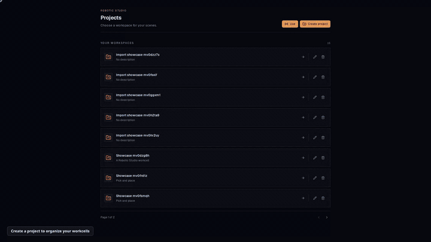
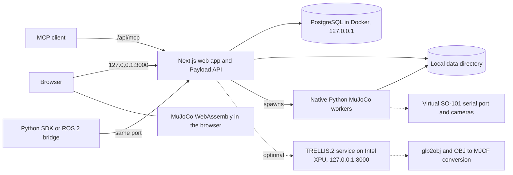

<!--
Copyright (C) 2026 Intel Corporation
SPDX-License-Identifier: Apache-2.0
-->

# Physical AI Scene Builder



Physical AI Scene Builder is a local, browser-based workspace for building robot simulation scenes,
running MuJoCo\* physics, generating demonstration datasets, and evaluating policies. It runs
entirely on your machine; no account or cloud service is needed.

## What You Can Do

| Workspace    | Capability                                                                                                                                        |
| ------------ | ------------------------------------------------------------------------------------------------------------------------------------------------- |
| **Build**    | Author scenes with the calibrated SO-101 arm, unit- and axis-calibrated objects, cameras, and lights                                             |
|              | Let an AI agent author the open scene through MCP (objects, furniture, robots, cameras, lights; saved with MuJoCo validation)                    |
|              | Create objects from an image (experimental TRELLIS.2, optional Intel® XPU service; [setup](services/README.md)) or convert textured OBJ + MTL     |
|              | Upload a Gaussian-splat scan (PLY or SPZ) as a backdrop with camera-hidden support tables (native scan images need an Intel® GPU)                |
| **Generate** | Randomize object poses, record SO-101 demonstrations, and download a raw dataset with training launchers                                         |
| **Evaluate** | From **Simulate** (**Driver: External app** + **Task** card), score ACT or Pi0.5 checkpoints (LeRobot\* or Physical AI OpenVINO\*) on seeded pick-and-place episodes, with success rate and run records |
|              | Run policies in your own Python process; add `--local --num-envs 4` to evaluate several seeds in parallel                                       |
| **Simulate** | Play, pause, reset, change speed, and set actuator targets in the browser                                                                        |
|              | Drive the scene from an external app with the Python\* SDK and score pick-and-place policies with the **Task** card                              |
|              | Expose the SO-101 as a virtual follower serial port (`/dev/ttyACMn`) and scene cameras as webcams (`/dev/videoN`) to Physical AI Studio          |

> The virtual SO-101 port is a pseudo-terminal linked as `/dev/ttyACMn`, not a real USB device.
> Tools that open the port by path work; tools that discover devices by USB vendor/product ID
> (for example, `lsusb` or `/dev/serial/by-id`) do not see it.

## Architecture

The web application, native workers, and optional image-to-3D service run directly on the host.
Only PostgreSQL\* runs in Docker\*, and it listens on `127.0.0.1`. Build and Simulate run MuJoCo in
the browser; Generate and Evaluate run MuJoCo in native Python\* workers started by the web
application.



## Requirements

### Validated Hardware

- CPU: Intel® Core™ Ultra Series 3 (Panther Lake)
- GPU: Intel® Arc™ Pro B70 Graphics
- RAM: 32 GB or more
- Disk: 512GB

### Validated OS

- Ubuntu\* 26.04 LTS

## Prerequisites

1. Install [Ubuntu 26.04 LTS](https://ubuntu.com/download/desktop).
2. Set up the platform with this project's installer scripts, which install the Intel® GPU drivers
   and Docker. See [Getting Started](../../../docs/getting-started.md).

   ```bash
   sudo ./main_installer.sh --with-extras=docker
   ```

3. Install the packages that `./setup.sh` checks for:
   - Node.js\* 20.9 or newer and npm 11 or newer
   - [uv](https://docs.astral.sh/uv/)
   - Git\*
   - `build-essential`, `pkg-config`, and `python3-dev`
   - A Chromium\*-based browser

   ```bash
   sudo apt-get update && sudo apt-get install -y build-essential pkg-config python3-dev git
   ```

4. Optional: for virtual cameras (**Simulate**), install and load the `v4l2loopback` kernel module.
   `./setup.sh` prints the commands if it is missing.
5. Optional: for image-to-3D, request access to the gated
   [DINOv3 model](https://huggingface.co/facebook/dinov3-vitl16-pretrain-lvd1689m) and create a
   Hugging Face\* read token.

## Quick Start

```bash
./setup.sh
```

Setup checks the prerequisites and does the following:

- Prompts for a PostgreSQL password. Leave it blank to generate one.
- Generates `PAYLOAD_SECRET` and writes the root `.env` and `apps/web/.env` with owner-only
  permissions.
- Downloads the DINOv3 model. Set `HF_TOKEN` or enter the token when prompted; setup does not save it.
- Installs the npm and Python dependencies and builds the app.

Start the app:

```bash
./start.sh
```

Open http://127.0.0.1:3000 to start using the app.

### Local-network access

By default the app listens on `127.0.0.1` only. To change this, set the root `.env` (defaults shown):

```dotenv
BIND_ADDRESS=127.0.0.1
PORT=3000
```

The app has no user authentication. Expose it only to trusted networks. PostgreSQL stays on
`127.0.0.1` regardless of `BIND_ADDRESS`.

- Python clients and MCP (`/api/mcp`) use the same port; native worker ports stay loopback-only.

## Known Issues

- The virtual SO-101 port is a pseudo-terminal, not a USB device, so tools that discover devices by
  USB ID do not see it.
- Image-to-3D is experimental. It needs an Intel® GPU with a compatible XPU runtime and approved
  access to the gated DINOv3 model. The first run downloads model weights and can take several
  minutes.
- Scripted demonstrations support the SO-101 only. Only one live simulation runs at a time, and
  real-robot evaluation is not available.
- `./setup.sh` stops if `build-essential`, `pkg-config`, or `python3-dev` is missing. Install them
  with the command in [Prerequisites](#prerequisites) and re-run it.
- Virtual cameras do not appear until `v4l2loopback` is loaded. Setup does not fail without it.
- If port `3000` or `5432` is in use, change `PORT` or `POSTGRES_PORT` in the root `.env`. If
  `POSTGRES_PORT` changes, re-run `./setup.sh` to update the database connection.

## References

| Document                                              | Contents                                         |
| ----------------------------------------------------- | ------------------------------------------------ |
| [Release notes](docs/RELEASE-NOTES.md)                | Changes per release and expected results         |
| [Features](docs/FEATURES.md)                          | Main capabilities and workflow                   |
| [Development guide](docs/DEV.md)                      | Setup and configuration                          |
| [Python control examples](integrations/python/examples/control-README.md) | Connect a Python client and control a scene |
| [ROS 2 bridge](integrations/ros2/README.md)           | Optional ROS control and RViz\* setup            |
| [Image-to-3D services](services/README.md)            | TRELLIS.2 and glb2obj setup                      |

\*Other names and brands may be claimed as the property of others.
