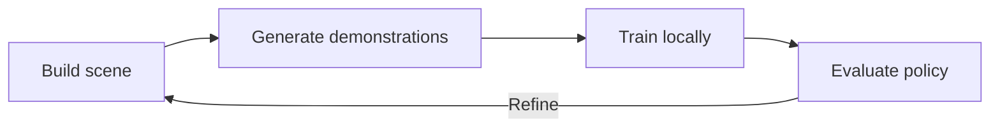

<!--
Copyright (C) 2026 Intel Corporation
SPDX-License-Identifier: Apache-2.0
-->

# Physical AI Scene Builder

Local tools for robot-scene authoring, demonstration generation, and policy evaluation.

## Features

- **Build:** edit MuJoCo* scenes; add robots, assets, cameras, and lights; use AI scene authoring, from photos or from a LeRobot* v3 recording of the real robot.
- **Generate:** randomize scenes, record demonstrations, review episodes, and download datasets.
- **Evaluate:** run supported policies and review results.
- **Integrate:** connect Python* clients or use the optional [ROS 2 bridge](../integrations/ros2/README.md).
- **Create assets:** upload scan backdrops or use the optional [image-to-3D service](../services/README.md).

## Limitations

- Scripted demonstrations support the SO-101 only.
- Only one live simulation runs at a time; real-robot evaluation is unavailable.

*Other names and brands may be claimed as the property of others.
