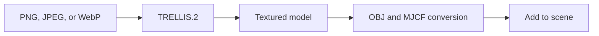

<!--
Copyright (C) 2026 Intel Corporation
SPDX-License-Identifier: Apache-2.0
-->

# Image-to-3D

Create a scene object from an image with the optional local TRELLIS.2 service.



## Setup

Requires the source installation, an Intel® GPU with a compatible XPU runtime, C/C++ and CMake,
plus access to the gated [DINOv3 model](https://huggingface.co/facebook/dinov3-vitl16-pretrain-lvd1689m).
Accept the model's access conditions before setup.

From the `physical-ai-scene-builder` workspace root:

```sh
uv sync --locked --project integrations/python --extra teleoperation --extra test --extra obj2mjcf --extra usd
uv sync --locked --project services/glb2obj
uv sync --locked --project services/trellis2-runtime
```

Authenticate as the account that runs the service:

```sh
uv run --locked --project services/trellis2-runtime hf auth login
```

Alternatively, provide `HF_TOKEN` in the service environment. Do not commit the token. The first
service start downloads model weights and may take several minutes. `./setup.sh` installs the
converter dependency and retrieves the pinned TRELLIS.2 source.

## Use

- In **Build > Assets > Create object > Image to 3D model**, choose an image up to 20 MB and a
  quality setting: `512`, `1024`, `1024_cascade`, or `1536_cascade`.
- The dialog starts the service and reports progress. Generated objects can be edited, saved, and
  included in scene exports.
- To convert an existing model, upload an OBJ with its MTL and up to 16 PNG/JPEG textures. Direct
  conversion accepts files up to 500 MB each.
- The service defaults to `http://127.0.0.1:8000`. Set `ROBOTIC_STUDIO_TRELLIS_API_URL` in
  `apps/web/.env` to use another service address.

## Limitations

- TRELLIS.2 requires authorized model access, compatible GPU hardware, and sufficient GPU memory.
- Generated scale and collision geometry are approximate; check objects in the scene before use.
- Neither service provides user authentication. Use only a trusted local network.

*Other names and brands may be claimed as the property of others.
