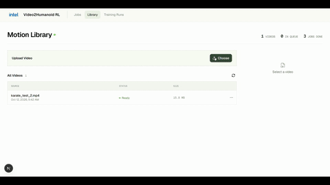

# Video-To-Action Humanoid Reinforcement Learning

Train and evaluate video to action humanoid reinforcement learning pipeline (GMVHR &rarr; GMR &rarr; unitree_rl_mjlab) on Intel Arc Pro B70 GPU with Ubuntu 24.04 LTS.

<div align="center">
  
  <p>Demonstration of Video2Action Humanoid RL training results.</p>
</div>

## Validated Hardware and OS

- **CPU**: Intel® Core™ Ultra Series 3 (Panther Lake)
- **GPU**: Intel® Arc™ Pro B70 Graphics
- **OS**: Ubuntu 24.04 LTS

## Getting Started

### Local Setup

To run locally, install Ubuntu 24.04 LTS system dependences and Intel drivers / toolchains using `install-deps.sh` and populate third-party libraries with custom patches using `install.sh`.
```bash
chmod +x scripts/*
./scripts/install-deps.sh
./scripts/install.sh
```

Then, please refer to the [Pipeline](#pipeline) section below for local use.

#### Local Browser GUI Usage

Alternatively, we provide a browser GUI for an interactive video processing &rarr; start training &rarr; evaluate training runs experience.  
  
*Note: running the GUI locally requires all the local setup scripts to be ran beforehand (see above).*

<div align="center">
  
  <p>Demonstration of Humanoid RL GUI, used to process data and launch training runs.</p>
</div>

To start the GUI locally, copy the `.env.example` file and run the backend and frontend in seperate terminals:

```bash
cp application/.env.example application/.env
```

```bash
cd application/backend
uv sync --group dev
uv run backend
```

```bash
cd application/frontend
npm ci
npm run api:types
npm run dev
```

By default, the frontend is at `http://localhost:3000` and the FastAPI backend is at `http://localhost:8000`. 

Please see [docs/GUI.md](docs/GUI.md) for detailed browser GUI usage instructions.

### Docker

See the [documentation](docker/README.md) for more details.
```bash
RENDER_GID=$(getent group render | cut -d: -f3) \
docker compose -f \
    humanoid-rl/docker/compose.yml \
    build \
    --build-arg HTTP_PROXY=${HTTP_PROXY} \
    --build-arg HTTPS_PROXY=${HTTPS_PROXY} \
    --build-arg NO_PROXY=${NO_PROXY}

```

The container runs as Ubuntu's non-root `ubuntu` user. Application data is
stored in a Docker-managed volume, so matching the container UID/GID to your
host account is not required.

```bash
RENDER_GID=$(getent group render | cut -d: -f3) \
docker compose -f docker/compose.yml up --build
```

Open `http://localhost:3008` after the container starts. By default, the Docker setup publishes the backend on `8008`, TensorBoard on `6767`, and the mjlab playback viewer on `8181`. See [docker/README.md](docker/README.md) for the port and networking details.

## Architecture
```text
┌─────────────────────────┐
│     Monocular Video     │ (Raw .mp4 / .mov)
└────────────┬────────────┘
             │
             ▼
┌─────────────────────────┐
│          GVHMR          │ Extract 3D human motion in SMPL-X format
│ (Human Motion Recovery) │ Outputs: hmr4d_results.pt
└────────────┬────────────┘
             │
             ▼
┌─────────────────────────┐
│           GMR           │ Retarget SMPL-X motion to Unitree G1 joint space
│(General Motion Retarget)│ Outputs: G1 retargeted motion (.pkl)
└────────────┬────────────┘
             │
             ▼
┌─────────────────────────┐
│     unitree_rl_mjlab    │ Convert motion to NPZ & train RL tracking policy
│   (MuJoCo Warp / PPO)   │ Outputs: policy checkpoints & ONNX policy
└─────────────────────────┘
```

## Pipeline - Scripts

The following steps are already encoded as scripts and can be found in `scripts/`. 

### Video Pre-Processing

The steps below should be done with an input video clip of <30 seconds. Therefore, if you have a video clip that is longer than 30 seconds, **please split it into <30 seconds clips and do the processing and training seperately per clip**.

Example `ffmpeg` usage for clipping a long input video:

```bash
ffmpeg -ss 00:00:05 -to 00:00:28 -i input.mp4 -c copy output.mp4
```

### Video Processing

1. `./scripts/process/process-gvhmr.sh <video.mp4|video.mov> <output-dir>`: extract a GVHMR prediction into the output directory.
2. `./scripts/process/process-gmr.sh <hmr4d_results.pt> <output-dir> <motion-stem>`: retarget a GVHMR prediction and export G1 motion and CSV files. The motion stem may contain letters, numbers, `_`, and `-`.
3. `./scripts/process/process-csv-to-npz.sh <motion.csv> <output.npz>`: convert a GMR CSV to an NPZ motion file.

To run all three steps in sequence, enter the path to an MP4 or MOV video when prompted:

```bash
./scripts/process.sh "$VIDEO_PATH"
```

The resulting motion file is written to `third_party/unitree_rl_mjlab/src/assets/motions/g1/` and can be passed to `./scripts/train.sh`.

### Train

- `./scripts/train.sh <motion.npz> [max_iterations=30001] [num_envs=4096] [device=xpu] [env_device=xpu] [run_label]`: train a policy on a converted motion file.
- `./scripts/resume.sh <motion.npz> <run-path> <checkpoint.pt> [max_iterations=30001] [env_device=xpu] [experiment=g1_tracking] [num_envs=4096] [policy_device=env_device] [run_label]`: resume training from a checkpoint.

```bash
./scripts/train.sh "$MOTION_FILE" 2001 4096 xpu xpu demo-run
```

By default, training run logs and checkpoints can be found at `third_party/unitree_rl_mjlab/logs/`.

### Play / Evaluation

- `./scripts/play.sh <motion.npz> <checkpoint.pt> [cpu|xpu] [port=8000]`: evaluate one trained policy in the MuJoCo viewer. The device defaults to `cpu`.
- `./scripts/play_chain.sh <cpu|xpu> [--port <port>] <checkpoint-1> <motion-1> <checkpoint-2> <motion-2> [...]`: play a sequence of policies. Supply at least two checkpoint/motion pairs, in that order; the port defaults to `8000`.

```
./scripts/play.sh "$MOTION_FILE" "$CHECKPOINT_FILE" cpu

./scripts/play_chain.sh cpu --port 8000 \
    "$CHECKPOINT_1" "$MOTION_1" \
    "$CHECKPOINT_2" "$MOTION_2"
```

## Pipeline - Commands

For completeness, the verbose steps are included as instructions here.

### 0. Clipping Long Video into Shorter Clips
```bash
ffmpeg -ss 00:00:05 -to 00:00:28 -i input.mp4 -c copy clip1.mp4
ffmpeg -ss 00:00:28 -to 00:00:41 -i input.mp4 -c copy clip2.mp4
```

### 1. Video2Simplx using GVHMR
```
cp <path_to_video> third_party/GVHMR/inputs/videos
cd third_party/GVHMR
source .venv/bin/activate

TORCH_FORCE_NO_WEIGHTS_ONLY_LOAD=1 python tools/demo/demo.py \
    --video "inputs/videos/<videofile>" \
    --output_root "outputs/demo_result"
```

### 2. Simplx2Robot using GMR
```
cd third_party/GMR
source .venv/bin/activate

MUJOCO_GL=egl python scripts/gvhmr_to_robot.py \
    --robot unitree_g1 \
    --gvhmr_pred_file "../GVHMR/outputs/demo_result/demo/hmr4d_results.pt" \
    --save_path "./outputs/demo/demo_g1.pkl" \
    --record_video

python scripts/batch_gmr_pkl_to_csv.py \
    --folder "./outputs/demo"
```

### 3. Training a motion imitation RL policy in mjlab
```
cd third_party/unitree_rl_mjlab
source .venv/bin/activate

python scripts/csv_to_npz.py \
    --input-file "../GMR/outputs/demo/csv/demo_g1.csv" \
    --output-name "demo_g1.npz"
    --input-fps 30 \
    --output-fps 50 \
    --robot g1 \
    --device "cpu"

python scripts/train.py Unitree-G1-Tracking-Sim2Real-No-Curriculum \
    --motion-file="src/assets/motions/g1/demo_g1.npz" \
    --agent.max-iterations=2001 \
    --env.scene.num-envs=4096 \
    --agent.logger="tensorboard" \
    --env-device="xpu"
```

### 4. Evaluate a trained policy
```
cd third_party/unitree_rl_mjlab
source .venv/bin/activate

tensorboard --logdir logs/rsl_rl/g1_tracking/<training_run_dir>

python scripts/play.py Unitree-G1-Tracking-Sim2Real-No-Curriculum \
    --motion_file="src/assets/motions/g1/demo_g1.npz" \
    --checkpoint-file "logs/rsl_rl/g1_tracking/<training_run_dir>/model_2000.pt" \
    --device "cpu" \
    --viewer "viser"
```

## References

- [GVHMR](https://github.com/zju3dv/GVHMR.git)
- [GVHMR_BEDLAM2](https://github.com/mkocabas/GVHMR_BEDLAM2)
- [GMR](https://github.com/YanjieZe/GMR.git) [MIT]
- [unitree_rl_mjlab](https://github.com/unitreerobotics/unitree_rl_mjlab?tab=Apache-2.0-1-ov-file) [Apache 2.0]
- [mjlab](https://github.com/mujocolab/mjlab.git) [Apache 2.0]
- [warp](https://github.com/NVIDIA/warp.git) [Apache 2.0]
- [mujoco_warp](https://github.com/google-deepmind/mujoco_warp.git) [Apache 2.0]
- [mjlab-sycl](https://github.com/guang384/mjlab-sycl.git) [Apache 2.0]